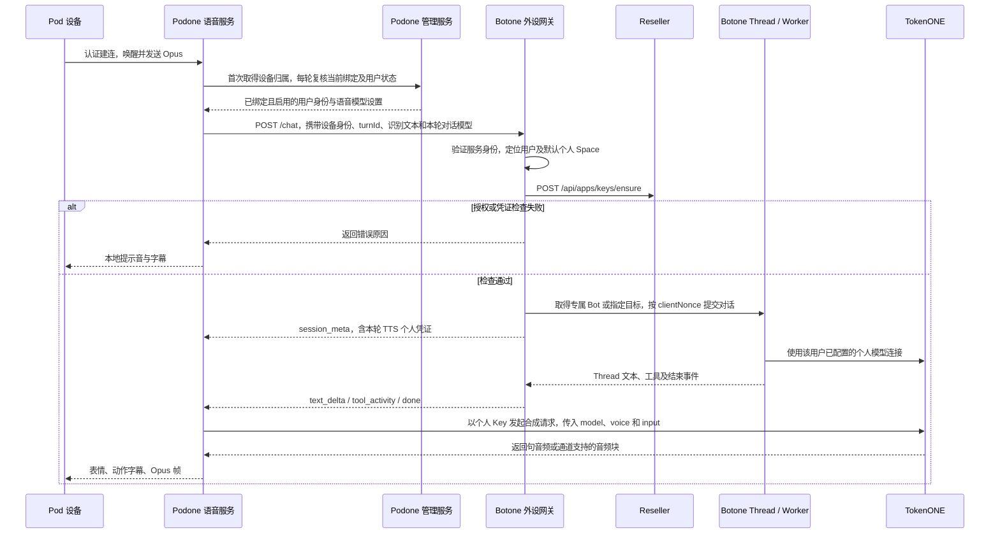

# Podone 接入 Botone 外设架构方案

2026-11-26 · Lab 已部署 Botone 的 Pod 设备工具、自然点歌和告别待机。1.75C 使用在线待机固件，点歌和告别的新说法待实板复测。

## 1 目标与分工

用户说“你好波波”唤醒桌面 Pod，可以快问快答、向专业 Bot 或群聊派活、查询进度、建立例行任务、批准或拒绝审批卡、回答追问、释放电脑接管和急停任务。用户也可以直接连线某个 Bot。1.75 寸圆屏显示表情、字幕和工具动作，扬声器播报回复、异步结果、来电和例行任务通知。

| 端 | 职责 |
| --- | --- |
| Botone | 理解用户想做什么，用既有 Harness 的 Skill 和工具完成任务。天气、新闻、搜索、提醒和跨 Bot 协作都在这里处理。每个用户复用个人 Space 的「波波」，角色、记忆、权限、审批和通话状态归 Botone。 |
| Podone 服务端 | 负责绑定、在线连接、OTA、断句、识别、语音模型与音色、播报队列和来电投递。对硬件工具负责核对当前设备归属、转发调用、返回执行结果。外设模式不加载旧天气和新闻插件，也不把它们用作兜底。 |
| Pod 固件 | 本地处理唤醒词、按键、IMU、回声消除、录放音、响铃和屏幕显示。执行音量、亮度、主题、动画、配网等硬件操作，返回实际结果，并切换待机、聆听、播放状态。 |

**扩展方式。** 新增通用能力时，先用 Botone 已有工具，缺什么就在 Botone 增加或启用相应 Skill 或工具。语音和文字共用这条路径，Podone 只需把识别文本送入对话。

**硬件工具接入。** Botone 的设备连接器复用 Harness 工具注册、审批和执行。Podone 从当前固件的 MCP 工具列表取得名称、参数和说明，仅向本次语音会话提供该设备实际支持且允许调用的工具。设备身份取自已验证的会话。调用沿现有设备连接下发，固件回执后 Botone 再答复；断线或换绑返回失败。以后固件增加标准 MCP 工具时，通过同一连接器暴露，按需配置权限。设备自身的唤醒和按键继续直接响应。

## 2 模型与音频

| 环节 | 实现与计费 |
| --- | --- |
| VAD / ASR | 首期在 Podone 运行 SileroVAD 和 SenseVoiceSmall，识别后才发起 Botone 请求。Botone 模式默认静默 1100 毫秒后断句，可用本地 `VAD.SileroVAD.min_silence_duration_ms` 覆盖。若以后启用云端 ASR，个人授权检查须提前到上传音频之前。 |
| 语音总控 | Podone 智控台选定低延迟模型，要求支持流式文本和工具调用。Pi 使用设备主人的个人模型连接执行，设置 `thinkingLevel: "off"`。专业 Bot 沿用各自的模型和工具。 |
| TTS | 正式环境由 Podone 持该用户的 TokenONE Key 按句合成，再按协商的下行采样率编码为 60 ms Opus 帧播放。内网 CPU 部署可选 Kokoro-82M。云端调用仅使用个人凭证。 |
| 回声消除与打断 | 1.75C 默认启用设备端 AEC。普通 WebSocket 复用现有音频发送和停止播放协议。现有服务端 `aec_audio_cache` 由启用服务端 AEC 的 MQTT 网关发送分支写入。 |

部署时记录用户说完到首段实际播放的时间，以及 ASR、授权检查、模型首字和 TTS 首音频耗时。短回复合成一次，长回复积累到一小段再按标点分批合成。TokenONE 的 MiniMax 适配器当前会读完整段上游响应。部署通道若支持增量音频，Podone 可在收到首块后开始编码。音频就绪后才通知设备开始播放，最后一帧播放完后恢复收音，用户可以直接追问。

原版由模型调用的 `play_music` 和 `handle_exit_intent`，现在对应 Botone 语音会话的两项预制工具。Botone 根据完整语义选择动作，只向发话设备执行。网页普通对话不提供这两项工具。

| 用户意图 | Botone 工具 | Podone 执行 |
| --- | --- | --- |
| “想听点音乐”“给我来一首《中秋月》” | `pod_play_music`，可传歌名 | 从本地曲库选歌并播放。未指定歌名时随机选，找不到时播报提示。播完恢复聆听。 |
| “行啦，今天就聊到这儿吧” | `pod_end_conversation` | 播放一次告别语并进入待机。明确的短口令“退下吧”也可直接执行。 |

Lab 已为波波的使用者在 Botone 审批设置中放行这两项工具，点歌和告别可直接执行。

天气由 Botone 现有联网工具查。用户点名的城市优先，其次取对话里已确认的所在地或用户设定的默认天气城市；缺少地点时问一句。说“以后默认查杭州天气”才更新偏好，单次查询其他城市不改默认值。时间使用 Botone 的当前时间和时区。农历、节气、黄历和新闻交给智能体现有能力，原版可选插件暂缓接入。

波波的长期行为规则由 Botone 的「波波 → 设置 → 指令」维护。首次创建时写入默认指令，同一 Space 的后续设备复用该 Bot。工具说明随当前 Pod 会话提供。Lab 的已有波波保留原角色，并在自己的指令里增加了点歌和告别规则。

### 原 Pod Server 能力核对

Lab 绑定设备的旧智能体配置了天气、NewsNow 新闻和本地音乐；旧服务还默认加载告别和农历。当前固件上报的 6 项普通 MCP 工具都在 Botone 连接器允许列表内。

| 原能力 | 目前的差异 |
| --- | --- |
| 农历、节气、干支、黄历宜忌 | 原版用日期计算。Botone 可搜索，尚无等价日历工具。 |
| 不报城市查当地天气、按预设新闻源听头条再听详情 | 天气使用用户确认的城市，新闻由智能体联网查询。旧版默认新闻源和上一条新闻的专用记录未带入。 |
| 通讯录呼叫另一台 Pod、切换预设角色 | 均为原版可选工具。当前支持与 Bot 通话、设置 Bot 角色，尚未接入两台 Pod 间的语音通话或原角色预设。 |
| Home Assistant、RAGFlow、旧 IoT 和自配 MCP 工具 | 原版可选。Botone 支持另配工具和知识源，旧设备、服务地址和知识库绑定不会自动迁移。 |
| 声纹区分说话人、Omni 图像／视频／原始音频对话 | 当前 Pod 只把识别文字交给 Botone。这些信息未进入对应 Bot 会话。 |
| 旧智控台录音回放、按设备限制每日输出、发音纠正词典和自定义上下文 | 新对话记录由 Botone 保存，设备外设路径跳过旧上报、输出限制和按智能体加载这些配置的流程。 |

1.75C 新固件在握手时声明 `online_standby`。旧固件继续通过断开连接进入待机。

- 唤醒应答复用普通回复的 TTS 模型和音色，Podone 缓存短应答，配置变化后重新生成。
- 普通答复播完继续聆听。说“退下吧”或空闲 120 秒时，Podone 通知固件进入待机，停止上传语音并保留在线连接。来电可唤起响铃和接听，拒接或无人接听后恢复待机。
- 1.75C 省电版在激活后主动以待机身份上线，Wi‑Fi 恢复后重连。待机使用 Wi‑Fi 省电档，本地监听唤醒词。默认待机 60 秒后息屏并暂停眼睛动画，来电、唤醒和触摸可亮屏。保持来电可用时禁用闲置关机。
- 设备实际断线时，Podone 结束该连接的播报任务并清空队列，重连后从新会话开始。

## 3 一轮对话



## 4 接入约定

### 4.1 设备归属与身份映射

- Podone 外设模式启用 WebSocket 凭证校验。Java 在原有设备激活时保存固件持久 UUID 的哈希。管理服务按 MAC 查绑定，再比对 WebSocket 的 Client-ID 与激活时保存的哈希，确认后读取 `ai_device.user_id` 和 `sys_user` 的 IDONE 身份及状态。历史绑定缺少 UUID 哈希，设备会提示通过原激活流程重新绑定。
- 建连时记录设备所属用户。发起收费轮次、提交特权动作或投递私有通知前，通过管理服务复查当前归属。管理服务同时返回智控台的语音模型设置。解绑、换绑、停用或归属无法确认时停止操作。归属变化时结束旧连接并清除排队播报，新主人从新连接进入。
- Podone 通过回环或受 TLS 保护的内网访问 Botone，沿用一个服务端 `PERIPHERAL_BRIDGE_SECRET` 鉴别调用方。Botone 按配置的 issuer、`providerId="oidc"` 和 `oidcAccountSubject(issuer, subject)` 查账户，用 `isCurrentOidcAccount` 校验绑定，取得当前成员身份后在 `runAsTenant(actor, ...)` 中执行。设备首次使用的前提是用户已在 Botone 建立对应 IDONE 账户和个人 Space。

### 4.2 「波波」与对话路由

| 配置 | 约定 |
| --- | --- |
| 创建 | 首个已获授权的语音请求按 `(spaceId, spawnKey="peripheral:podone")` 创建或复用「波波」。同一用户的多台 Pod 共用这个 Bot。 |
| 模型与指令 | 默认 Pod 对话发送智控台配置的 `chatModel`，网关验证该模型可通过用户的个人模型连接调用，再固定到本轮 Run。指定 Bot 或群聊时发送目标，由各 Bot 的模型设置决定。回复用 1–3 句自然口语，开头带情绪 Emoji，省略 Markdown、裸链接和代码。 |
| 派活与进度 | 开启 `manageOtherBots`。用 `list_fleet` 查车队，`message_bot` 或 `post_to_group` 派活，`spawn_bot` 和 `create_child_routine` 建 Bot 与例行任务。工具确认受理后才播报“已安排”。 |
| 工具范围 | 将电脑、浏览器、文件和页面操作交给专业 Bot。通过现有 `disabledBuiltinTools` 禁用 `shell`、`computer_observe`、`computer_act`、`browser_navigate`、`browser_snapshot`、`browser_act`、`user_computer_list`、`user_computer_shell`、`user_computer_observe`、`user_computer_act`、`open_path`、`launch_app`、`request_takeover`、`list_files`、`read_file`、`write_file`、`attach_file`、`save_page`。创建时使用 Botone 的工具名校验。 |

Lab 已将绑定板子的原角色设定一次性写入主人现有的「波波」，保留原 Thread 和指令版本历史。后续在 Botone 编辑角色。

每次新发言由 Podone 生成唯一 `turnId`，同一句重试沿用原值。普通对话映射为 `pod:<deviceKey>.<turnId>`，专线沿用 `call:<callId>:<deviceKey>.<turnId>`，均作为 Botone 的 `clientNonce`。`deviceKey` 由设备 ID 和当前绑定标识计算，异步结果据此回到发起设备。网关复用 Thread 的发送回执与事件游标；重复提交同一句应返回原消息及执行结果，避免重复派单。

默认目标是「波波」的 Thread。对 Pod 说“发给运营群，整理今天的待办”，会发到已匹配群聊的 Thread，成员按 Botone 群聊的消息规则执行。用户说“连线代码助手”时，当前设备连接保存已校验可访问的 `targetBotId` 和 `callId`，说“退出连线”时清除。专线采用 Botone 的通话指令；需要浓缩长回复时，显式调用现有 `speechSummary` 逻辑并播报摘要。普通回复可以直接按文本增量分句。

圆屏从首个有效文本提取表情，移除 Emoji 后再交给 TTS；工具活动沿用 `send_display_message` 显示动作字幕。用户中途开口时，沿用现有打断处理清队列、向设备发停止播放、关闭当前回复流，丢弃旧轮迟到的音频。新发言走正常 Thread 发送路径，由 Botone 判断能否引导正在运行的任务。用户明确要求急停时才调用任务停止入口。

### 4.3 审批、追问、接管与异步投递

**语音决定。** 绑定设备旁的人可以代表主人批准或拒绝操作。网关以设备主人的身份提交决定，只列出主人有权处理的挂起项。播报时说明 Bot、动作和对象，例如“收件箱机器人要把报价单发给张三，同意吗？”当前设备连接记住这次实际播报的卡片引用（Thread、Run、消息 ID）及可选动作。多项有歧义时先请用户指明；“同意”“拒绝”“已完成”只作用于这张卡。提交时复核设备归属，再走 Botone 的原有审批、工具问答或接管处理入口，保留接收人检查、状态冲突和恢复执行的语义。收到 Botone 成功回执后再播报“已批准”或“已拒绝”。网页已处理或卡片已过期时，播报当前状态。当前设备没有播报过待答卡时，一句“同意”按普通对话处理。急停同样先确定目标 Thread。

访问网站时，Pod 会播报“波波想访问 example.com 上的网页。请说同意或拒绝。”如果卡片支持记住网站许可，还可以说“以后允许这个网站”。Botone 按当前账号或空间的审批设置保存相应网站的许可。希望减少审批时，可在 Botone 的「设置 → 审批」选择「从不询问」。

**异步结果、来电和通知。** Podone 订阅 Botone 已有的 Thread 与通知事件，通过现有设备 WebSocket 投递。派单时把发送回执与发起设备关联；专业 Bot 以 `intent="result"` 回到「波波」后，网关沿用原派单消息的关联，将简短结果送回原 Pod。直接派给群聊的任务以对应 Run 完成事件推送结果，即使最初的聊天 SSE 已结束。离线或归属已变化时，结果留在 Botone Thread，用户可稍后询问。游标重连时按事件 ID 去重，避免重复播报。

`call_user` 与例行任务完成沿用上述订阅及播放路径。有来源设备时优先送原 Pod；无来源设备时，默认选该用户最近交互且仍在线的一台 Pod。来电先响铃，用户接听后进入相应 Bot 专线。无人在线时沿用 Botone 原有通知记录。多台 Pod 连接同一 Podone 服务实例时，该实例按上述规则选择播报设备并去重。

### 4.4 个人计费与 TTS

每个新收费轮次由外设网关先调用一次 Reseller `POST /api/apps/keys/ensure`，请求体为 `{"identity":{"issuer":"…","subject":"…"}}`。检查通过后，Pi worker 沿用同一用户在 Botone 配置的个人模型连接；外设网关把此次取得的 Key 放进仅发给 Podone 的 SSE 首帧。

```json
{
  "type": "session_meta",
  "turnId": "turn_…",
  "botId": "bot_…",
  "threadId": "thread_…",
  "runId": "run_…",
  "cursor": 12,
  "tts": {
    "baseUrl": "https://tokenone.work/v1",
    "apiKey": "<个人 Key>"
  }
}
```

这是 Reseller 返回的持久个人 Key。轮次限制由 Podone 执行：每个 TTS 队列项持有对应轮次的凭证引用和 `sentence_id`，分句共用该引用，播完或打断即释放。异步结果或通知需要云端合成时，按一次新的播报重新检查归属与授权，复用同一取凭证逻辑。本地提示音、来电铃声可直接播放。

Podone 在读取设备归属时一并读取智控台维护的对话模型、TTS 模型和本次播报音色。本轮使用同一份配置。语音服务调用 TokenONE 的 `POST /v1/audio/speech` 时，将 `ttsModel` 和 `ttsVoice` 分别放入请求体的 `model` 和 `voice`。包含凭证的响应设置 `Cache-Control: no-store`，仅在受信服务之间发送。Key 仅用于配置的 TokenONE 目标。日志、Thread 事件、持久化通知和设备消息都不携带它。外设模式关闭公共付费 Key 回退。

未授权（`APP_USER_AUTHORIZATION_REQUIRED`）、额度耗尽（`TOKENONE_KEY_QUOTA_EXHAUSTED`）和服务暂不可用分别使用本地提示。首次使用时，若找不到对应账户，提示“请先用同一个 IDONE 账号登录 Botone”；若已有账户但尚未授权，提示“请到 Botone 完成模型授权”。用户完成后再次开口即可。Botone 的 Reseller 适配器目前将多数 4xx 归为 `rejected`，需保留额度错误的分类。若授权检查通过后 LLM 或 TTS 才遇到额度错误，结束该轮剩余收费调用，同样播放离线提示。

## 5 三端改造落点

在 **Podone 智控台 → 参数管理 → `podone.voice.models`** 填写 TokenONE 已启用的对话模型 ID、TTS 模型 ID 和默认音色 `ttsVoice`。用户可在设备绑定的角色配置页选择并保存音色。角色的 TTS 模型配置中的 `model` 与这里的 `ttsModel` 一致时，下次语音回复、唤醒或独立播报使用该角色选中的音色编码。未选择、音色已删除或模型不匹配时使用管理员默认音色。个人 Key 随用户授权取得。

```json
{
  "chatModel": "<对话模型 ID>",
  "ttsModel": "<TTS 模型 ID>",
  "ttsVoice": "<所选 TTS 通道支持的音色标识>"
}
```

Botone API 配置 `PERIPHERAL_BRIDGE_SECRET` 和原有 `MODEL_ACCOUNT_CONNECTION`。Podone 使用相同共享凭证访问 Botone。启用主动来电时，API 和 Worker 设 `PHONE_CALLS_ENABLED=true`，Worker 同时设 `PERIPHERAL_CALLS_ENABLED=true`。

硬件工具由 Worker 访问 Podone 语音服务上的内网接口。Lab 的 Botone 服务配置 `PERIPHERAL_DEVICE_URL=http://127.0.0.1:8003/internal/device-tools/`，鉴权复用 `PERIPHERAL_BRIDGE_SECRET`。Podone 默认开放设备状态、音量、亮度、主题、动画和重新配网。增加硬件工具时，在 `botone.device_tools` 中配置允许的固件 MCP 原名列表；该列表覆盖默认值。

Podone 的 `data/.config.yaml` 示例如下。保留现有 `manager-api` 连接配置，在后台开启 `server.auth.enabled`，通过 HTTPS 提供设备 OTA 和 WSS。使用本地合成时，可在 `botone.local_tts` 配置兼容接口的 `baseUrl`、`model` 和 `voice`。

```yaml
botone:
  url: https://bot.example.test
  secret: replace-with-a-random-shared-secret-at-least-32-characters
```

对话入口通过 JSON 的 `error` 字段返回可播报的失败原因。`account_required` 表示缺少可用的 Botone 账户或个人 Space，`authorization_required` 表示需要到 Botone 完成模型授权，`model_connection_required` 表示个人连接不可用或未提供本次指定模型，`quota_exhausted` 表示额度耗尽。

| 位置 | 改动 |
| --- | --- |
| Botone · `apps/api/src/peripheral/`、`app.ts` | 集中实现并挂载外设路由。`POST /api/peripheral/v1/chat` 接受设备身份、`turnId`、文本，以及对话模型或指定目标，返回本轮 SSE。`POST /fleet` 查询车队和可处理项，`POST /decisions` 提交指定卡片、任务或来电动作，`POST /events` 转发异步结果、来电和通知，`POST /speech` 取得单次通知播报所需的个人 TTS 凭证。各端点同属 `/api/peripheral/v1`，设备身份在请求体中传递。 |
| Botone · 既有模型账户、Thread、审批与事件处理 | 外设路由复用个人模型连接、发送回执、权限检查和事件游标。在 Reseller 适配处保留需要播报的错误原因。 |
| Podone · Java 管理服务 | `/config/peripheral-owner` 复用设备与用户查询，供语音服务建连及操作前读取归属与智控台语音模型设置。外设语音会话跳过旧聊天历史上报和 Java 标题、摘要生成。 |
| Podone · Python 语音服务 | 在 `core/providers/llm/botone/` 接入网关；`core/connection.py` 管本连接的目标、轮次与待答卡，外设模式只加载本地 VAD/ASR，识别文本直达外设会话。分句队列接收轮次凭证，打断处理关闭旧流并停止播报。异步投递复用在线连接与同一播放队列。 |
| Pod 固件 | 沿用 1.75C 的唤醒、设备端 AEC、表情、字幕和 Opus 协议。来电响铃、接听或退出专线使用现有播放与语音输入能力。 |

## 6 分阶段交付与验收

| 阶段 | 交付 | 关键验收 |
| --- | --- | --- |
| A · 外设网关与「波波」 | 身份反查、授权检查、幂等初始化、Thread 对接 | 同一用户两台 Pod 并发首次请求只创建一个「波波」；工具配置通过正式 schema；普通问答不启动沙箱。使用隔离 Postgres 测试，运行 Botone 的 `pnpm checks`。 |
| B · 语音与个人计费 | 设备认证和归属复核、个人模型连接、分句 TTS、表情及打断 | 两个账户同时说话，LLM 和 TTS 消费各归本人；解绑换绑后旧连接的下一轮被拒绝；未授权和额度不足有对应本地提示。在目标通道记录首音频时间，打断后不再播放旧轮音频。 |
| C · 协作与人工决定 | 派单到 Bot 或群聊、建 Bot 与例行任务、查进度、异步结果、专线、审批、追问、接管及急停 | 模拟派单成功后断线重发，同一请求只派一次；首轮 SSE 结束后结果仍送原 Pod。验证切入及退出专线、工具字幕、两张待审卡的消歧、网页先处理后的语音冲突，以及指定任务的恢复和停止。设备旁的人说“同意”即可批准刚播报的卡片，Botone 按设备主人的权限执行。 |
| D · 主动外呼与通知 | 接入 `call_user` 和例行任务完成事件 | 在线 Pod 响铃并可接听；同一通知只在选定设备播报一次；设备离线时仍可在 Botone 查看记录。 |

本轮验收用同一用户的两台 Pod 检查“把音量调到三成”只改变发话设备，设备掉线时能听到或在 Thread 看到失败结果。天气和新闻通过 Botone 原有工具完成；给「波波」启用一项新 Skill 后，直接从 Pod 语音调用。实板另测唤醒与回复音色一致、回复后能追问、待机停止上传音频、待机中来电能接听、断线重连后没有旧播报。
