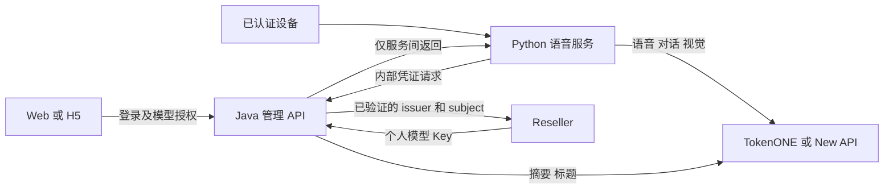

# 小智 Reseller 接入实施方案

状态：方案编制及代码对照复核完成，尚未实施。本文作为后续开发和验收依据。

目标：所有已启用的云端模型调用使用所属用户的 Reseller 授权，模型请求由 Java 或 Python 直接发往 TokenONE / New API。保留硬件问答的流式处理和打断体验，取消公共模型 Key 及厂商凭证的静默回退。

核心设计：Java 集中处理身份和授权；Python 继续负责语音与对话；可按请求执行的能力在一轮问答内复用一次 ensure 结果。跨轮不缓存 Key，不建设独立凭证服务、刷新调度器或通用授权状态机。

## 1 接入范围

| 范围 | 处理原则 |
| --- | --- |
| 主对话 LLM、辅助 SLM、视觉 VLLM、Omni | 使用智能体所属用户的授权；显式维护模型能力和协议 |
| 意图识别、记忆查询或总结中的模型调用 | 包含单独配置的辅助模型，不遗漏隐含调用 |
| Java 摘要、标题、历史记忆合并 | 从关联智能体解析用户，独立任务独立 ensure |
| 云端 ASR、TTS、音色试听、声音克隆等已启用能力 | 先核对网关协议和音色支持；按实际调用入口迁移 |
| 知识库、MCP 和插件内部的模型调用 | 纳入清单；第三方服务内部无法传递用户凭证的模型调用列为阻塞项 |
| 本地 VAD、本地离线模型 | 保留，不需要 Reseller Key |
| 天气、搜索、家居控制等非模型接口 | 保留原服务认证，不替换成模型 Key |

先盘点运行环境实际启用的模型与音色，不将仓库中存在的全部 Provider 都纳入适配。未适配的云端入口不能在切换后继续绕过 Reseller；需替换或经明确范围调整后停用，不静默删除用户功能。

本期不增加余额、价格、用量看板或统一登录导航改造。保留已经接入的 IDONE 登录和现有用户、设备、智能体数据。

## 2 依据与现状

用户提供的[在线接口文档](https://doc.tokenone.work/web/#/689214373/172712480)当前读取返回无访问权限。本方案依据同机 Reseller 的 [APPLICATIONS.md](../../tokenone_reseller/docs/APPLICATIONS.md)、[接入说明](../../tokenone_reseller/docs/CREATIVEONE_RESELLER_MIGRATION.md)，以及 CreativeOne 的 [tokenone.ts](../../creativeone/server/src/tokenone.ts) 和 [reseller-auth.ts](../../creativeone/server/src/reseller-auth.ts)。上线前须核对目标部署的实际契约。

代码对照确认：

- 当前 Java 已保存精确的 IDONE issuer/sub，模型配置通过 `ConfigServiceImpl` 下发给 Python。
- Java `OpenAIStyleLLMServiceImpl` 自行调用模型生成摘要和标题，必须一起迁移。
- Reseller ensure 会执行授权检查，并请求 New API 检查 Key；它不是单纯读取本地缓存。
- Python `sentence_id` 在 `chat()` 才生成，ASR 和意图处理发生在此前；`session_id` 则覆盖整个设备连接。两者都不能直接充当完整输入轮次的凭证隔离标识。
- TTS 分段执行，逐段 ensure 会增加额外等待。管理 API 客户端默认超时 30 秒、最多重试 6 次、重试间隔 10 秒，实时取凭证不能直接沿用这套失败行为。
- 当前 Qwen Omni 为 HTTP 多模态输入、流式文本输出。Omni 加意图识别还可能先调用模型转录音频，不能只覆盖最终回答入口。

## 3 服务职责

Reseller 应用凭证仅由 Java 持有。Python 使用现有服务认证访问内部接口；浏览器和设备均不能取得上游 Key。音频、图片和模型流不经 Java 中转。

模型定义继续存储模型 ID、能力、参数和音色。个人 Key 不写入数据库模型配置、公共 Redis 配置或日志，也不跨业务请求保存。服务间凭证响应设置 `no-store`，反向代理及 APM 禁止采集认证头和响应正文。

复用现有 HTTP 传输设施和连接生命周期，不为此重写网络层。当前管理 API 客户端关闭 keep-alive 有历史原因，不能顺手全局打开；若实测连接建立成为瓶颈，再单独验证针对本接口的调整。模型 HTTP 连接可以复用，但不得靠修改共享默认认证头切换不同用户。

## 4 用户身份与授权

### 用户归属

- Web/H5 操作从已验证的应用 Token 解析用户。
- 设备模型调用先验证设备凭证，再查设备、智能体和所属用户，检查归属一致及用户启用状态。
- 后台任务从任务关联的智能体解析用户，不依赖请求线程登录态；任务归属失效时停止，不改用管理员身份。
- 管理员测试和音色试听若产生模型请求，也必须有明确的调用用户。服务配置刷新等控制连接不获得模型调用权限。
- 每次新业务处理重新核对归属；设备换绑、智能体转移和用户停用后，不继续沿用旧连接的用户信息。

连接内的用户或智能体归属发生变化时，拒绝继续并结束旧连接，重新认证后加载新配置与对话上下文；不能只更换 Key 后继续发送原用户的历史消息。模型选择改变时，旧调用上下文也需失效，通过现有配置重载或重连机制生效。

issuer/sub 仅取自服务端已验证身份，不接受浏览器任意填写，不按邮箱或用户名合并账号。New API 中的用户及 OAuth 绑定、分组权益需事先存在；应用不自动开户或补授权益。

### 授权流程

1. 用户主动操作或模型使用时，Java 调用 `POST /api/apps/keys/ensure`，请求体只含 `identity.issuer/subject`。
2. 仅 `APP_USER_AUTHORIZATION_REQUIRED` 引导用户点击“授权模型服务”。服务故障、额度不足等不发起授权跳转。
3. Java 在 Redis 保存授权事务，绑定当前登录态摘要、用户身份、浏览器事务 Cookie、服务地址与应用凭证摘要、站内返回目标和 PKCE verifier。使用安全随机 state、PKCE S256，按契约保留 300 秒；不存储长期应用 Token 原文。
4. 调用 `/api/apps/authorizations` 后，浏览器顶层导航至返回地址。同一登录态的重复发起复用或提示已有流程，不建立新的并行事务管理框架。
5. 服务端回调先验证浏览器、state、原登录态仍有效且身份未变，再原子消费事务并调用 `/authorizations/complete`。登出、账号切换、超时和重放均拒绝兑换。
6. 兑换响应不明时，只通过 ensure 判断结果，不重复兑换一次性 code。成功返回保存的站内页面，不自动重发收费请求。
7. “断开模型服务授权”调用 `/authorizations/revoke`；普通退出仅退出本应用。模型授权不依赖用户持续登录浏览器。

授权回调建议为 `APP_ORIGIN/xiaozhi/user/reseller/callback`，与 IDONE 回调分开登记。浏览器回调不会自动携带前端的应用 Token 请求头，必须通过 HttpOnly、Secure、SameSite=Lax 的事务 Cookie 与服务端记录完成绑定；返回目标只允许固定客户端入口或经过验证的站内路径。

授权相关响应禁止缓存和 Referrer 传播，认证 URL 的 query/body 不进入日志。错误页清除地址栏中的 code/state，保留手动重试入口，不循环跳转。

## 5 实时问答的最小凭证传递

### 一轮的执行边界

对可按请求执行的能力，一轮从本次输入的第一个云端模型请求开始，覆盖本次 ASR、意图识别、Omni 转录、主回答、工具续答和分段 TTS。输出完成、输入被过滤、没有后续输出的意图处理返回、失败或取消后，不再发起该轮的新模型请求。意图或工具直接回答时，需等其排队的 TTS 完成，不能把函数返回误当作语音处理结束。

本轮首次云端调用之前执行一次 ensure，后续沿调用链传递结果。不在每个 Provider 内各自 ensure，不按每段 TTS 重新取 Key。仅本地处理的输入无需 ensure。连接建立和公共配置加载也不预先获取用户 Key。

实现只需一个轻量的本轮数据对象或等价局部参数，包含处理标识、服务端解析的归属和凭证结果，并传递给线程任务与 TTS 队列。处理标识在首次云端调用前建立，再关联后续 `sentence_id`；不新增持久化轮次表、独立管理器或通用状态机。

这一小范围上下文是必要的隔离手段，不能简化成修改全局配置或单个可变的 `conn.api_key`。旧轮任务捕获自己的凭证引用，不能在执行时读取新轮覆盖后的值。沿用现有打断和队列丢弃逻辑，补齐处理标识校验；取消后到达的 ensure 结果直接丢弃。

默认在现有处理入口完成一次取凭证后再分发，不额外建设请求合并池。首版不做录音开始时的投机预取；只有硬件实测证明取凭证显著影响首音频时，才在有效录音事件与现有缓冲范围内加入异步预取，不增加音频缓冲上限。

### 独立任务和持续流

- 独立视觉请求、后台摘要、标题和独立记忆任务各自 ensure，不借用结束的问答轮次。
- 自动问候、告别、工具直接播报若需要云端模型，也必须在执行前取得所属用户凭证；本地提示音无需授权。
- 持续连接的 ASR/TTS 不能直接套用“HTTP 每轮替换请求头”。在能力盘点阶段确认其认证时机、连接复用范围、Key 变化处理和停止行为。
- 持续流只有在能于下一轮开始前检查授权、拒绝未授权的新音频，并正确处理 Key 或分组变化的情况下才可接入。若无法在不退化体验的前提下满足这些条件，则该能力是切换阻塞项，不能悄悄改成整个连接共用一次授权。
- 不强制每轮重建云端音频连接，也不为未确认存在的持续流设计通用续期机制。

### 撤销边界

本方案选择业务轮次级检查，区别于 CreativeOne 各模型请求前 ensure 的粒度。已开始的一轮可能继续完成，下一轮或独立任务重新 ensure 后拒绝；不承诺跨实例立即终止在途调用。原生模型请求仍受 New API 的 Key、账号、额度与权限检查约束，生效时效以实际网关为准。

撤销、应用停用、应用凭证失效均不等于已发出的原生 Key 被停用。当前执行范围内的凭证复用不是长期缓存或后续请求授权依据；部署契约若要求逐上游请求 ensure，必须先调整方案，不能隐瞒频率差异。此边界在联调前核对。

## 6 模型配置与兼容性

管理员继续维护启用模型及默认值，用户在允许范围内选择模型。网关和应用模型白名单共同限制实际调用；模型 ID 不用于猜测能力。网关地址由服务端配置确定，浏览器不能指定携带个人 Key 的请求目标，也不跟随任意重定向转发凭证。

按实际启用项建立兼容清单：模型 ID、请求协议、工具调用、图像或音频输入、思考参数、ASR 流式方式、TTS 音色与首音频、克隆或试听能力、依赖服务中的模型调用。

优先复用现有兼容 Provider，只调整参数和凭证入口。不为统一接口而把流式 ASR 换成整段文件转录，或把流式 TTS 换成完整音频下载。普通 OpenAI Provider 当前按厂商域名关闭思考，迁移网关后需显式配置模型支持的参数，避免域名改变导致思考模式意外开启。

所有使用个人凭证的实例均按用户隔离；同模型 ID 不代表同凭证。检查现有 ASR/VAD 差异配置与实例共享逻辑，仅无用户凭证的本地组件允许共享。关闭 Omni 环境变量及其他云端厂商 Key 的回退，保留非模型服务独立凭证。

## 7 失败处理与性能要求

### 实时请求

拟定实时取凭证的端到端总预算为 3 秒，自动重试为 0 次；预算包含 Python 到 Java、Reseller 和上游 Key 检查。该数值是待基线验证的实施默认值，影响故障时的等待与成功率；联调前记录最终值，不直接继承管理 API 的 30 秒超时及多次重试。

Java 向下游传播取消和剩余预算；Python 超时后结束本轮并播放本地错误提示，丢弃迟到结果。不能把每一跳都各设为 3 秒后宣称总预算为 3 秒。保留底层连接超时的合理上限，真正采用的参数写入部署说明。

| 结果 | 行为 |
| --- | --- |
| 未授权 | 结束本轮，提示到 Web/H5 授权；不在设备端循环跳转 |
| 用户不存在、身份冲突、账号停用、缺少权益 | 分类提示并停止，不自动创建账号或换 Key |
| Key 或账户额度不足 | 停止收费请求，不改用公共 Key |
| 应用凭证错误或应用停用 | 返回模型服务配置错误，不当成本地用户登录失效 |
| ensure 超时或服务错误 | 结束本轮，后续用户输入可重新尝试；不沿用上一轮 Key |
| 模型响应结果不明 | 不自动重发可能已执行的收费请求，不重新播放已成功音频 |

只调整本次涉及的实时请求失败策略，不全局改变管理 API 的其他业务重试。检查 SDK 隐含重试和 TTS 基类最多五次尝试，阻止认证、权限、额度错误反复执行；付费操作结果不明时也不盲目重试。

### 速度验证

主指标为用户说完话到硬件播放首段语音的时间，同时记录 ensure、ASR、LLM 首 Token、TTS 首音频及打断停止耗时。使用现有日志和测试记录，不引入监控平台。

比较相同硬件、模型、音色、提示词和输入下的 P50/P95；覆盖首次使用、连续问答、工具续答、多用户并发和故障。区分授权增加的等待与模型或音频协议更换造成的变化，样本不足时不把百分位当稳定结论。

基线采集后明确首音频可接受增量及最终取凭证预算，满足后才切换。保留现有输出分段和打断逻辑；已有记忆检索属于当前业务链路，不以本次接入为由重构，只保证不新增加摘要、标题或额外检查阻塞回答。

## 8 预计改动范围

| 位置 | 必要改动 |
| --- | --- |
| Java 新增 Reseller 模块 | 客户端、配置、授权事务及回调、错误映射；直接复用现有身份和 Redis |
| Java 配置模块 | 复用设备和智能体归属查询；公共模型定义与个人凭证分离 |
| Java 内部凭证接口 | 在现有服务认证下提供单一按需接口；不每轮重新组装全部插件、音色和系统配置 |
| Java LLM 与摘要服务 | 传递智能体归属，按独立任务 ensure；不从后台线程读取当前登录用户 |
| Python 管理 API 客户端 | 保留结构化错误码，实时凭证请求单次执行且可取消 |
| Python 输入入口、连接及实际使用的 Provider | 传递本轮凭证，覆盖语音、文字、Omni 转录、意图、工具续答和 TTS 队列 |
| Python 视觉及认证入口 | 去除 `web_test_client` 等绕过；Web 调试走已认证用户上下文 |
| Web 与 H5 | 最小授权状态、授权按钮、断开按钮、回调结果及错误提示；不增加轮询 |
| 部署与说明 | 注入独立应用凭证、网关地址、CA、日志脱敏、迁移清单和验收记录 |

采用单独的轻量内部取凭证接口，原因是现有 `agent-models` 会组装大量无关配置，而模型配置只在连接初始化取得一次；复用完整接口到每轮会增加工作量并混淆配置缓存与凭证生命周期。该接口复用现有查询方法，不另建用户映射系统。

内部接口接受设备及当前业务关联标识，Java 自行解析所属用户，并核对调用使用的智能体与模型选择仍然有效；不接受外部指定扣费用户、issuer/sub 或网关地址。返回仅供服务端使用的凭证及必要归属、分组信息；发生归属或模型配置不匹配时，返回需要重连或重载的错误，而非静默切换。Java 后台任务直接调用同一服务方法，不通过 HTTP 调用自身。

不新增模型 Key 数据库表，不修改关联项目源码或自动注册平台应用。当前工作区已有 IDONE 等变更，开发在此基础上追加，保留已有内容。

## 9 实施顺序与验收

| 阶段 | 交付 | 进入下一阶段的条件 |
| --- | --- | --- |
| 一 盘点与基线 | 实际模型、音色、入口清单和硬件延迟基线 | 明确持续流方案、所有不兼容项和轮次级授权适用性 |
| 二 授权基础 | Java 接入及 Web/H5 授权往返 | 模拟验证身份、state、PKCE、重放、退出和错误分类 |
| 三 运行时接入 | Python 与 Java 模型调用改造 | 所有启用入口覆盖；双用户与重叠轮次不串用凭证 |
| 四 真实联调与切换 | 实际调用、权限及延迟对照、部署记录 | 功能、身份隔离和硬件体验通过；无公共 Key 回退 |

平台准备：小智独立应用，建议应用 ID 为 `xiaozhi`；应用默认分组、`keys:ensure` 和 `groups:read`、精确 HTTPS 回调、允许 issuer、用户原生 OAuth 绑定和分组权益。分组不可直接照搬 CreativeOne；应用凭证只交付 Java，不使用 New API 管理员令牌。核验 Java/Python 容器的 DNS、网关与 Reseller CA 信任。

关键验收：

1. 两个用户使用同一模型、同一用户多设备并发，以及打断后的新旧轮重叠，均不串凭证或输出；从上游消费记录核对归属。
2. 设备换绑、用户停用、模型或分组调整后，下一轮正确拒绝或使用新配置，不凭旧连接继续扣费。不能仅以 ensure 成功证明模型仍有权限。
3. 语音、文字、独立视觉、Omni 意图转录、工具续答、记忆、摘要、标题、试听及自动播报均有明确授权来源。
4. 授权取消、错误 state、重放、错误 PKCE、退出后回调、切换账号、兑换响应丢失、凭证轮换均正确处理。
5. Reseller 撤销或故障后，新轮不再使用旧 Key；在途一轮边界与第 5 节一致。浏览器关闭、正常服务重启不要求重新授权，但新任务仍执行 ensure。
6. 取凭证超时符合总预算；永久错误无自动重试；收费请求结果不明无重复提交。
7. 模型配置缓存、前端、设备消息、日志及 APM 中无应用凭证或个人 Key。模型认证目标固定且不通过重定向泄露凭证。
8. ASR/TTS 协议、音色、首音频和打断体验通过实际硬件对照，不以取 Key 成功代替模型验收。

切换前备份配置、数据库和运行镜像，保留模型映射和原音色选择。上线不自动撤销旧厂商 Key。回退是恢复已验证的应用版本及相配配置的运维操作，不是请求失败时自动使用公共 Key；恢复数据库前另存切换后的新增业务数据。

## 10 再次 Review 结论

结论：最小架构可实施，保留的复杂度主要来自个人计费的身份隔离和实时音频协议。以下修订已经纳入方案；运行效果仍需按第 9 节验收。

| 发现 | 处理结论 |
| --- | --- |
| 每个 Provider、每段 TTS 都 ensure 会重复等待 | 改为可按请求执行的能力在一轮内只取一次；独立任务单独取 |
| 直接复用 `sentence_id` 不能覆盖 ASR 和意图 | 首次云端调用前建立轻量处理标识，再关联原输出标识；不新增轮次框架 |
| 只增加 `conn.api_key` 会导致并发覆盖 | 按任务传递稳定凭证引用，禁止公共配置及共享认证头的原地切换 |
| 换绑后仅更新 Key 可能把旧用户对话发到新账号 | 归属变化时结束旧连接，重新认证并加载新上下文 |
| 原有管理 API 超时与重试不适合硬件交互 | 实时凭证调用独立总预算、零自动重试，保留其他业务策略 |
| 录音预取、并发合并池、刷新和跨实例即时撤销增加首版复杂度 | 预取仅在实测需要时增加；其余不纳入首版 |
| 强制每轮重建持续音频连接可能降低体验 | 按实际协议核对下一轮授权检查和凭证变化；不兼容即阻塞切换 |
| “不缓存 Key”不等于无需携带执行期凭证 | 只保留当前业务执行引用，公开说明轮次级撤销边界，不承诺内存即时擦除 |
| 为复用配置接口而每轮拉全量配置并不简单 | 采用一个必要的轻量内部接口，复用归属查询，避免引入通用凭证 API 集合 |
| 只改主 LLM 会漏掉收费入口 | 显式覆盖 Java 后台、Omni 转录、意图、记忆、自动播报及第三方内部模型 |
| 改网关地址可能改变思考行为或音频协议 | 显式参数和能力清单，硬件首音频对照作为切换条件 |

实施前仍需落实三项条件：目标部署接受的授权检查粒度；实际启用 ASR/TTS/Omni 与音色的网关兼容性；基线测量后的响应目标及实时取凭证最终预算。这些属于接口和运行环境条件，不通过增加框架或静默放宽规则来规避。
